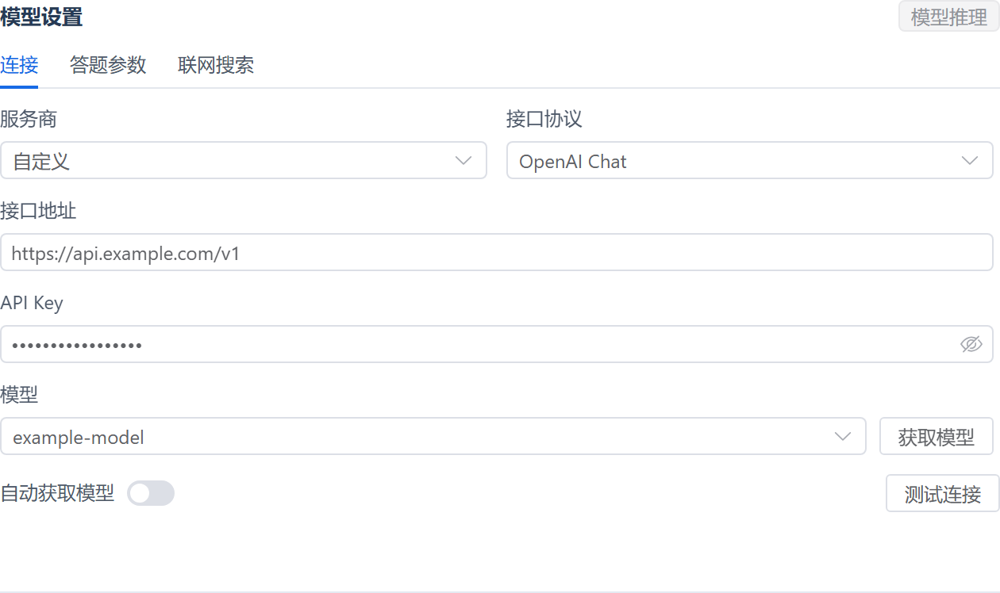
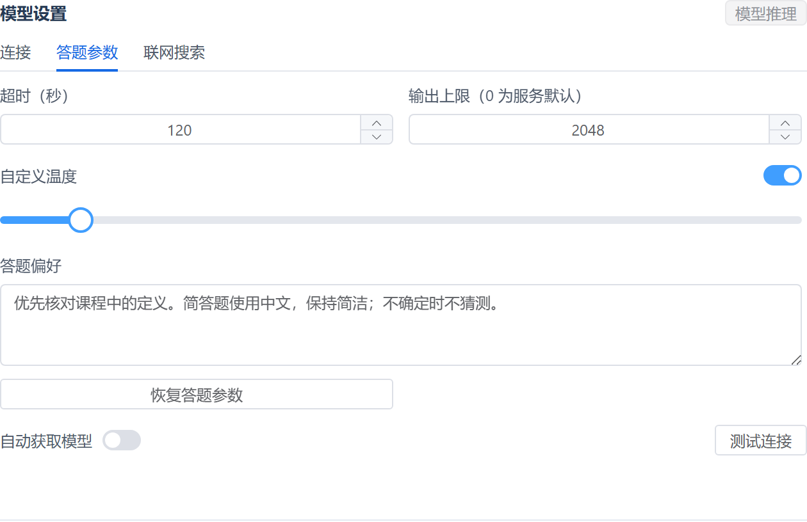
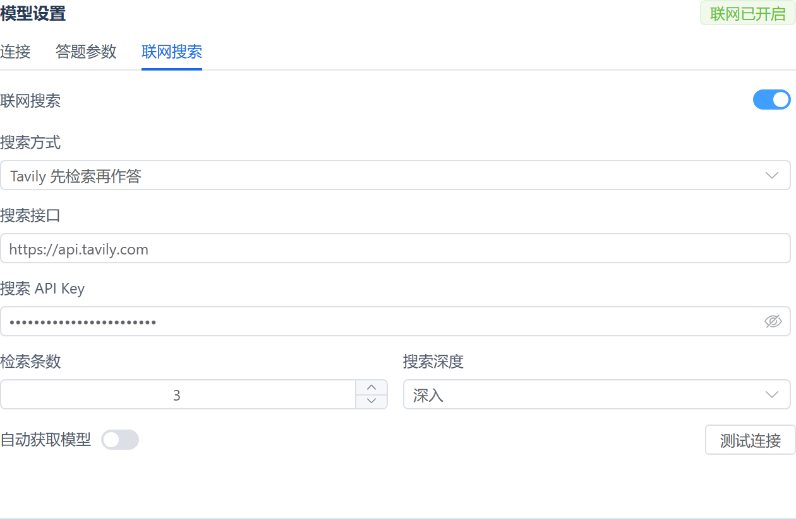

<div align="center">

# CoursePilot AI

**网课 AI 助手 · 自选模型，联网查证**

超星学习通 / 知到智慧树的浏览器用户脚本。使用自己的模型接口获取答案，接入原有题目填写与课程流程。


**[安装脚本](https://raw.githubusercontent.com/Waffing/CoursePilot-AI/main/scripts/coursepilot-ai.user.js)** · **[新手教程](docs/quick-start.md)** · [参数与接口](docs/configuration.md) · [版本下载](https://github.com/Waffing/CoursePilot-AI/releases)



</div>

## 有什么特色

| 功能 | 使用体验 |
| --- | --- |
| 自选模型服务 | OpenAI、DeepSeek、百炼、硅基流动、Kimi、Claude、Gemini、Ollama，支持自定义接口。 |
| 自动获取模型 | 输入接口与 Key 后自动读取模型列表，支持筛选和手动输入模型 ID。 |
| 联网查证 | 原生搜索或 Tavily 先检索再作答；展示服务返回的来源。 |
| 独立连接配置 | 切换服务商时恢复各自的地址、Key、模型和答题参数。 |
| 可调答题参数 | 超时、输出上限、温度与答题偏好集中管理，配置自动保存。 |
| 接入既有流程 | 模型输出转换为原答案格式，沿用原脚本的填写、播放、章节导航与提交实现。 |

支持 OpenAI Chat、OpenAI Responses、Anthropic Messages、Gemini 四种协议。**平台页面、具体模型和中转网关的兼容性，以实际测试为准。**

## 从这里开始

1. 在桌面浏览器安装 [Tampermonkey](https://www.tampermonkey.net/)，按扩展提示开启用户脚本权限。
2. 点击 **[安装脚本](https://raw.githubusercontent.com/Waffing/CoursePilot-AI/main/scripts/coursepilot-ai.user.js)**，停用原版和其他同类脚本。
3. 打开课程页面，先在“设置”里关闭自动提交，再到“答题 → 模型设置 → 连接”填写接口和 Key、选择模型。
4. 点击“测试连接”。通过后刷新页面，再核对实际填写结果。

第一次使用，请按 **[完整新手教程](docs/quick-start.md)** 操作，包含下载导入、接口填写、搜索配置和常见错误处理。

## 界面预览

<table>
  <tr>
    <th width="50%">答题参数</th>
    <th width="50%">联网搜索</th>
  </tr>
  <tr>
    <td valign="top"></td>
    <td valign="top"></td>
  </tr>
</table>

截图来自实际 Vue / Element Plus 组件，使用演示地址和假 Key；不代表真实服务或课程验收。[查看服务商选择界面](docs/assets/providers.png)。

## 如何联网

| 方式 | 使用条件 |
| --- | --- |
| 服务商原生搜索 | 已接入 OpenAI Responses、Claude、Gemini 和百炼 Chat 的搜索工具；所选模型与接口必须支持对应工具。 |
| Tavily 检索 | 单独填写 Tavily Key，先检索资料再调用模型。适合没有原生搜索工具的 Chat 接口。 |

联网默认关闭。Tavily 检索失败或没有有效资料时停止本题；原生接口未返回搜索记录时会明确标注，不能据此确认执行了检索。[查看配置方法](docs/quick-start.md#5-需要时再开启联网搜索)。

## 使用前知道这些

> 原版“正确率”按**拿到答案的题数**计算，并不校验答案正确或完整填写成功。章节作业的原默认配置可能自动提交，因此首次使用请先关闭自动提交。此修改保留了原流程，不保证答案正确。

- 模型和搜索服务可能收费。题干与选项会发给模型，开启搜索后题干也会发给搜索服务。
- Key 保存在脚本管理器 GM 存储，页面 localStorage 配置不含 Key；GM 存储没有加密，不要公开导出的配置。
- 图片题尚未增加视觉输入。学习通与智慧树的既有支持范围不同，未新增所有页面的最终交卷功能。
- 脚本仍保留上游公告及外部依赖，不是完全离线软件。本仓库提供的是修改版，不是课程平台官方产品。

## 文档与验证

| 文档 | 内容 |
| --- | --- |
| [新手教程](docs/quick-start.md) | 从安装到首次连接、搜索设置、排错和更新。 |
| [参数与接口](docs/configuration.md) | 服务商、协议、参数范围、保留机制和数据发送范围。 |
| [验证记录](docs/verification.md) | 40 项离线测试、16 项模拟接口浏览器检查及其边界。 |
| [上游与许可](THIRD_PARTY_NOTICES.md) | 原始来源、作者、SHA-256 与 MIT 许可说明。 |

开发者可用 Node.js 22 或更新版本运行：

```sh
npm run check
npm test
```

## 来源

基于 [GreasyFork 488083](https://greasyfork.org/scripts/488083)，原作者 **isMobile**，原始版本 `0.2.8`，上游声明 MIT 许可。本仓库由 **Waffing** 发布，增加模型接入、联网搜索、模型发现和配置面板。原始副本保存在 [upstream/](upstream/)。

[MIT License](LICENSE) · [反馈问题](https://github.com/Waffing/CoursePilot-AI/issues)
